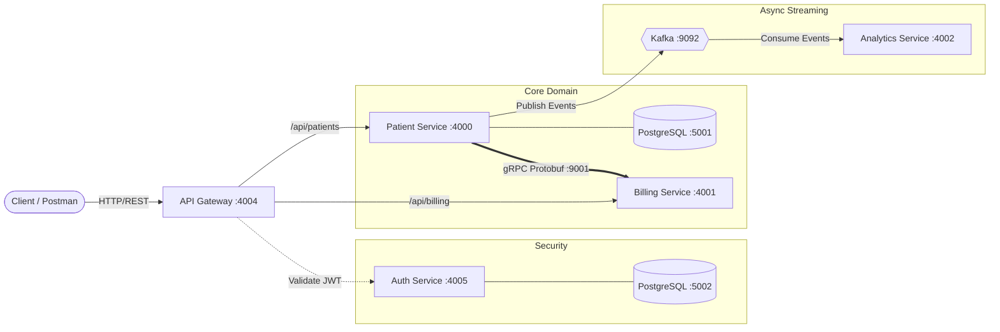

# 🏥 Patient Management — Distributed Microservices Platform

[](https://openjdk.org/)
[](https://spring.io/projects/spring-boot)
[](https://spring.io/projects/spring-cloud-gateway)
[](https://grpc.io/)
[](https://kafka.apache.org/)
[](https://www.postgresql.org/)
[](https://www.docker.com/)

A production-grade, event-driven healthcare backend built with **Spring Boot 3**, **Spring Cloud Gateway**, **Apache Kafka**, **gRPC**, and **PostgreSQL**. Demonstrates strict microservice data isolation, low-latency inter-service RPC, asynchronous event streaming, and centralized perimeter authentication.

---

## 🏛️ System Architecture



---

## 📦 Modules & Responsibilities

| Module | Protocol / Port | Role & Key Responsibilities | Data Store |
| :--- | :--- | :--- | :--- |
| **`api-gateway`** | HTTP `:4004` | Unified ingress reverse proxy. Handles routing, CORS, and centralized stateless JWT verification before traffic enters the private network. | Netty Reactive |
| **`auth-service`** | HTTP `:4005` *(internal)* | Manages user registration, BCrypt credential hashing, and digital issuance of signed HMAC-SHA256 JWT tokens. | PostgreSQL (`auth-service-db`) |
| **`patient-service`** | HTTP `:4000` *(internal)* | Core patient domain logic. Persists patient records, initiates synchronous billing creation via gRPC, and publishes domain events to Kafka. | PostgreSQL (`patient-service-db`) |
| **`billing-service`** | HTTP `:4001`<br/>gRPC `:9001` | Handles invoicing and accounts. Exposes a high-throughput gRPC server (`:9001`) for instantaneous inter-service calls from `patient-service`. | Persistent Store |
| **`analytics-service`** | HTTP `:4002` | Asynchronously consumes patient lifecycle events from Kafka topics to compute real-time metrics and audit trails without impacting write throughput. | Kafka Stream Ingestion |
| **`kafka`** | TCP `:9092` | Distributed event streaming broker running in modern KRaft mode (ZooKeeper-less) for resilient asynchronous pub/sub messaging. | Apache Kafka 4.2.2 |

---

## ⚡ Key Architectural Highlights

- **Infrastructure as Code (IaC)**: Complete cloud architecture codified in Java using AWS CDK (FlociStack.java), supporting ECS Fargate tasks, CloudMap namespaces, RDS instances, and ALB. Tested locally via Floci.io / LocalStack.
- **Database-per-Service**: Independent PostgreSQL instances for `auth-service` and `patient-service`, guaranteeing zero schema coupling and full data isolation.
- **Polyglot Inter-Service Communication**:
  - **REST & gRPC**: REST for client-facing APIs and gRPC for high-performance inter-service communication (patient-service <-> billing-service).
  - **Kafka (Event-Driven)**: Non-blocking, asynchronous pub/sub messaging decoupling core patient operations from downstream analytics.
- **Edge Security Filter**: Custom `JwtValidationGatewayFilterFactory` on Spring Cloud Gateway ensures zero unauthorized traffic enters the private network.

- **Infrastructure Deployment**:
    - **Live Production Hosting**: Containerized with Docker Compose & deployed on an Oracle Cloud (OCI) ARM instance.
    - **IaC & Enterprise Cloud Architecture**: AWS CDK in Java for production-grade AWS deployment (ECS, RDS, MSK, ALB).
    - **Local Cloud Emulation**: Floci.io / LocalStack for zero-cost CloudFormation testing.

---

## 🛠️ Tech Stack

- **Backend**: Java 21, Spring Boot 3, Spring Cloud Gateway, Spring Data JPA, Spring Security
- **Protocols & Streaming**: REST, gRPC, Protocol Buffers (Protobuf), Apache Kafka 4.2.2 (KRaft)
- **Database**: PostgreSQL 18
- **DevOps, Cloud & IaC**: Docker, Docker Compose, Oracle Cloud Infrastructure (OCI) & AWS CDK via floci.io


## 🚀 Quickstart (Local)

```bash
git clone https://github.com/sudarshan-mane/patient-management.git
cd patient-management
```

Spin up the entire microservices stack with a single command:

```bash
docker compose up -d --build
```

- **Ingress Gateway**: `http://localhost:4004`
- **Auth Service**: `http://localhost:4004/auth`
- **Patient Service**: `http://localhost:4004/patients`

